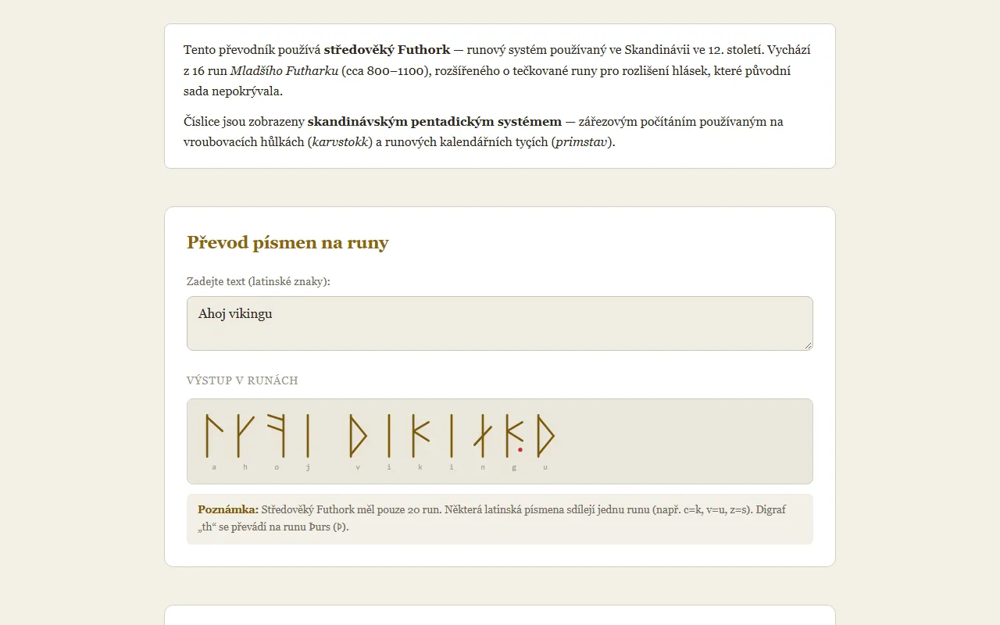

# Vikingský převodník run

Převádí latinský text na runy **středověkého Futhorku** (Skandinávie, 12. století) a čísla na **pentadický číselný systém** ze skandinávských vroubovacích hůlek a runových kalendářů.

**▶ Vyzkoušet: [frenkees.github.io/translate.viking](https://frenkees.github.io/translate.viking/)**

## Jak to funguje

Celá aplikace je jeden soubor [`viking-runes.html`](viking-runes.html) (HTML, CSS a JavaScript, bez knihoven a bez buildu). Runy se kreslí jako SVG. Převod respektuje omezení historické abecedy: některá latinská písmena sdílejí jednu runu (c = k, v = u, z = s) a digraf „th“ se převádí na runu Þurs.

## Spuštění

Stačí otevřít `viking-runes.html` v prohlížeči.

## Jak vzniklo

Malá jednorázová hříčka postavená s Claude Code.

## Licence

[MIT](LICENSE) © 2026 Pavel Procházka
